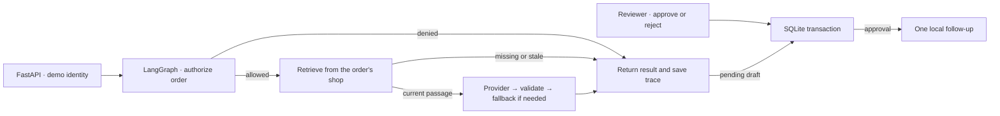

# Repair Ops AI Governance Demo

A collision repair reviewer needs to know which procedure applies, which documentation is missing, and who approved the follow-up. This independent portfolio demo uses fictional shops, repair orders, users, and procedures to show how an assistant can cite its evidence, respect shop access, recover from model failure, and keep task creation under human control.

## Run locally

From the repository root with Python 3.12:

```sh
python3.12 -m venv .venv
source .venv/bin/activate
python -m pip install -c constraints.txt -e .
python -m repair_ops.cli demo
```

The demo uses a temporary SQLite database and the deterministic local provider. It shows a cited recommendation, cross-shop denial, human approval and retry, and recovery from a simulated primary failure. Installation downloads packages from PyPI. Running the demo needs no API key, AWS account, or paid service.

To inspect the interactive API, run `python -m uvicorn repair_ops.app:app_from_env --factory --no-access-log` and open [the local API docs](http://127.0.0.1:8000/docs). The API uses `repair-ops.sqlite3` by default. Set `REPAIR_DB` to choose another local file.

## Architecture



`X-Demo-User` selects an identity from a server-side mapping. The Cedar Arc and Flint Vale writers each have one shop. The regional reviewer can access both shops and decide drafts. This header is **demo-only** and can be impersonated by anyone with API access. Run the app on loopback.

A single LangGraph passage reaches the provider only after the order and procedure pass shop checks. Missing or archived procedure evidence ends the workflow before model execution. When both providers fail or produce invalid results, the API returns HTTP 503 and records the attempts. Citation and outcome are checked against the scoped passage and the order's attachment list. Provider exception text stays out of the audit record.

## Worked example

Cedar Arc's `RO-101` describes front bumper camera calibration and has no attachments. The workflow retrieves `CED-CAMERA@2`, which calls for a calibration report, and suggests requesting it. Run these commands against the local API:

```sh
BASE=http://127.0.0.1:8000
REVIEW=$(curl -fsS -X POST -H 'X-Demo-User: cedar-writer' "$BASE/reviews/RO-101")
printf '%s\n' "$REVIEW" | python -m json.tool
RUN_ID=$(printf '%s\n' "$REVIEW" | python -c 'import json, sys; print(json.load(sys.stdin)["request_id"])')

curl -fsS -X POST "$BASE/reviews/$RUN_ID/decision" \
  -H 'X-Demo-User: regional-reviewer' -H 'Content-Type: application/json' \
  -d '{"decision":"approve"}'

curl -fsS -H 'X-Demo-User: cedar-writer' "$BASE/reviews/$RUN_ID/trace"
```

Approval returns an outcome and a local follow-up ID. Retrying the approval returns the same ID. A rejection records the decision and leaves the follow-up table empty for that run. An opposing decision after either final state returns HTTP 409.

Example approved trace from the local demo:

```json
{
  "request_id": "9445a762-e426-41c5-a4d1-ed4672cd69fd",
  "policy_decision": "allowed",
  "outcome": "draft_follow_up",
  "evidence_ids": ["CED-CAMERA@2"],
  "prompt_version": "repair-review-v1",
  "provider_attempts": [{"provider": "local", "status": "ok"}],
  "fallback_attempted": false,
  "latency_ms": 1.164,
  "approval_outcome": "approved",
  "decided_by": "regional-reviewer"
}
```

Every review response includes a request ID. Its trace shows the attempted providers, approval status, and provider-supplied token counts when available. Latency is wall-clock time through the workflow, before the trace write. Audit output omits order payloads, passage text, prompts, and credentials.

## Verification

```sh
python -m pip install -c constraints.txt -e '.[test,bedrock,mcp]'
python -m pytest -q
python -m repair_ops.cli eval
```

Local results: **14 tests passed** and **8 of 8 labeled keyword and workflow cases passed**. The tests cover citations, shop scope, abstention, model errors and invalid output, auditable fallback, concurrent approval retries, rejection, trace fields, a real MCP stdio round trip, and a Bedrock adapter called through a fake SDK client. CI runs the same commands without secrets.

The [labeled dataset](evaluation/cases.json) checks HTTP status, evidence IDs, outcome, and reason on synthetic cases. These results measure the behavior of the deterministic baseline on the checked-in fixtures. Live model quality and real repair outcomes were outside the evaluation.

## Optional adapters

- **Amazon Bedrock:** Install `.[bedrock]` with the constraints file. Set `REPAIR_BEDROCK_MODEL_ID` to a Converse-compatible model or inference profile and configure an AWS region and credentials through the SDK's credential chain. The app uses the local provider as fallback. The adapter has a mocked test. **Live Bedrock is unverified.** [AWS Converse documentation](https://docs.aws.amazon.com/boto3/latest/reference/services/bedrock-runtime/client/converse.html)
- **MCP:** Install `.[mcp]` with the constraints file. Configure a local MCP client to run `python -m repair_ops.mcp_server --demo-user cedar-writer` using the virtual environment interpreter. The read-only `get_repair_order` tool takes only an order ID and uses the same scoped lookup as FastAPI. The trusted local operator sets the identity when starting the process.

## Design trade-offs and production requirements

- Exact keyword matching makes passage selection reproducible and quick to inspect. It misses synonyms and multi-procedure cases. A broader labeled dataset would be needed before comparing a semantic retriever or using the scores to choose operating thresholds.
- A single SQLite transaction makes approval and task creation atomic and gives retries a stable task ID. It serializes writers and is suitable for a local demo. Shared deployment would need a managed datastore, and any external task integration would need durable delivery and idempotency across systems.

Before deployment, replace the demo identity selector with authenticated users and enforced shop roles. Add controlled procedure publication and expiry, monitoring, audit retention, and review of data handling for any hosted provider. Expand the evaluation with authorized domain-reviewed cases, including incomplete and conflicting procedures, and test model output quality and failure behavior in the intended environment.
